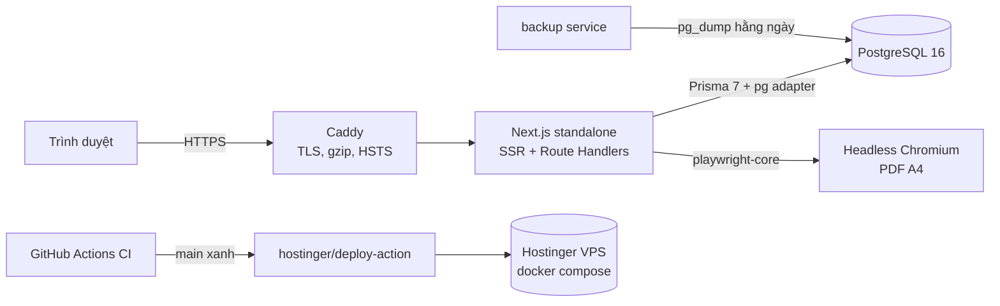

# Architecture — Toán Vui

## 1. Tổng quan

Một ứng dụng **Next.js 16 (App Router)** duy nhất phục vụ cả giao diện, API và PDF — không microservice, không Redis/queue (chưa có nhu cầu thực tế, giảm chi phí vận hành).



## 2. Cấu trúc mã nguồn

```
src/
  app/
    (public)/            trang học sinh: /, /[grade], /[grade]/[chapter], /[grade]/[chapter]/[topic], /thu-vien, /de-bai/[slug], /tao-de
    admin/login          đăng nhập
    admin/(panel)/       trang quản trị (layout kiểm tra session server-side)
    api/                 public API + api/admin/* (RBAC)
    sitemap.ts robots.ts icon.svg not-found.tsx
  components/  ui/ layout/ math/ worksheet/ admin/
  features/    questions/ (snapshot, transitions)  worksheets/ (select-questions — thuần, có test)
  lib/         auth/ db/ math/ pdf/ security/ validation/ env http labels slug utils
  repositories/  truy vấn Prisma (catalog, question, worksheet)
  services/      nghiệp vụ (catalog, question, import, worksheet, generator, pdf, stats, user, audit)
  generated/     Prisma Client (sinh tự động, không commit)
  proxy.ts       (Next 16 "middleware") chuyển hướng /admin khi chưa có cookie
prisma/  schema.prisma  migrations/  seed.ts  data/ (curriculum, questions, worksheets, verify)
tests/   unit/  integration/  e2e/  support/
```

Phân lớp: **Route/Page → Service → Repository/Prisma**. Validation bằng Zod ở biên (route handler). Trang server component gọi service trực tiếp (không fetch API của chính mình); client component gọi `/api/admin/*` cho thao tác ghi.

## 3. Quyết định kỹ thuật chính

| Quyết định | Lý do |
| --- | --- |
| Prisma 7 + `@prisma/adapter-pg` | Phiên bản stable hiện tại, query compiler không cần binary engine lúc runtime |
| Định dạng nội dung **MathText** (văn bản + `$LaTeX$`, `**đậm**`, gạch đầu dòng) — không lưu HTML | Chống XSS từ gốc; render bằng KaTeX `trust:false`, mọi văn bản được escape (`src/lib/math/render.ts`) |
| Render KaTeX phía server | Trang học sinh không phải tải KaTeX JS; PDF dùng cùng HTML |
| `QuestionRevision` + `WorksheetQuestion.questionRevisionId` | Đề và đáp án (web + PDF) luôn đọc từ cùng snapshot bất biến |
| PDF bằng headless Chromium (playwright-core) | Hỗ trợ tiếng Việt, KaTeX, phân số chính xác; font nhúng base64, chặn toàn bộ network, CSP `default-src 'none'` |
| Trang công khai `force-dynamic` | Nội dung admin xuất bản hiển thị ngay; truy vấn nhẹ (< 100 ms) |
| Session DB (token ngẫu nhiên 256-bit, lưu HMAC-SHA256) | Thu hồi được (đổi mật khẩu/khóa tài khoản), không phụ thuộc thư viện auth beta |
| Rate limit in-memory | Triển khai 1 instance trên VPS; khi scale ngang cần store chung |
| Caddy | HTTPS tự động (Let's Encrypt), cấu hình 10 dòng |

## 4. Luồng chính

**Xem đề:** `/de-bai/[slug]` → `getWorksheet` (snapshot đã ghim) → `toPublicQuestions` (chỉ nội dung + phương án, không `isCorrect`) → HTML. Nút "Xem đáp án" gọi `GET /api/worksheets/:id/answers`.

**Tạo đề:** `POST /api/worksheets/generate` → Zod → rate limit → lọc câu `PUBLISHED` theo phạm vi → `selectQuestions` (không trùng, cân bằng theo dạng, dễ → khó hoặc trộn) → kiểm tra đủ số câu (422 nếu thiếu) → lưu `Worksheet(kind=GENERATED)` + ghim revision mới nhất → trả URL. Đề tự tạo có `noindex`, không vào sitemap; dọn bằng `npm run cleanup:generated`.

**PDF:** `GET /api/worksheets/:id/pdf | /answers/pdf` → rate limit → HTML template (escape toàn bộ) → Chromium (tối đa `PDF_MAX_CONCURRENCY` song song, browser dùng chung, tự đóng khi rảnh) → cache LRU trong RAM theo (worksheet, updatedAt, revisions) → ghi `downloads`.

**Duyệt nội dung:** `DRAFT → PENDING_REVIEW → APPROVED → PUBLISHED` (`src/features/questions/transitions.ts`). EDITOR chỉ gửi duyệt; ADMIN duyệt/xuất bản/lưu trữ/xóa. Mọi thao tác ghi `audit_logs`.

## 5. Bảo mật

| Mối đe dọa | Biện pháp |
| --- | --- |
| Truy cập trái phép Admin | `requireAdminPage` / `requireApiUser` server-side cho mọi trang/API; `proxy.ts` chỉ là lớp chuyển hướng |
| Leo quyền | RBAC `src/lib/auth/permissions.ts`; không tự đổi vai trò/khóa chính mình; luôn còn ≥ 1 admin |
| CSRF | Cookie `SameSite=Lax`, `httpOnly`, `Secure` (HTTPS); kiểm tra `Origin`/`Sec-Fetch-Site` cho mọi mutation |
| XSS | Không lưu HTML (Zod chặn thẻ HTML ngoài công thức); escape + KaTeX `trust:false`; CSP; JSON-LD escape `<` |
| SQL injection | Prisma parameterized; tham số route kiểm tra regex |
| IDOR | Public chỉ đọc nội dung `PUBLISHED`; dữ liệu admin chỉ qua API có RBAC |
| Brute force / lạm dụng | Rate limit: đăng nhập 5/15 phút (theo IP và email), tạo đề 10/phút, PDF 30/phút, báo lỗi 5/10 phút, import 10/10 phút |
| PDF injection | Template escape, CSP trong trang PDF, chặn mọi request mạng của Chromium |
| Lộ đáp án | API danh sách/chi tiết đề không chứa `answer`/`solution`/`isCorrect` (có test E2E) |
| Lộ secrets | Chỉ qua biến môi trường; `.env` bị gitignore; log lỗi không chứa dữ liệu request |
| Header | CSP, X-Frame-Options DENY, nosniff, Referrer-Policy, Permissions-Policy, HSTS (Caddy) |

Lưu ý: CSP cho phép `'unsafe-inline'` script vì Next.js chèn script hydrate inline; có thể nâng cấp lên nonce-based CSP sau.

## 6. Mở rộng lớp 7–9

Thêm lớp trong Admin → Lớp học (trạng thái Nháp), thêm chương/dạng toán, nhập câu hỏi, rồi xuất bản lớp. Route `/[grade]`, sitemap, API và generator service đọc từ DB nên không cần sửa schema hay backend. Việc còn lại khi có lớp thứ hai: mở dropdown "Lớp" trên `/tao-de` (hiện cố định Lớp 6), thêm lớp vào menu header và bộ lọc lớp ở `/thu-vien`.
